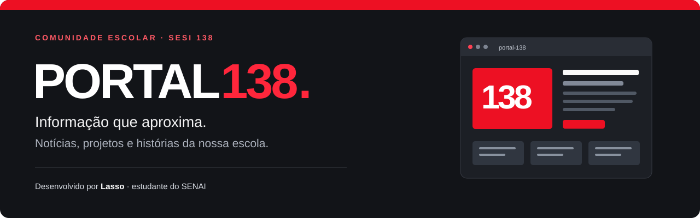
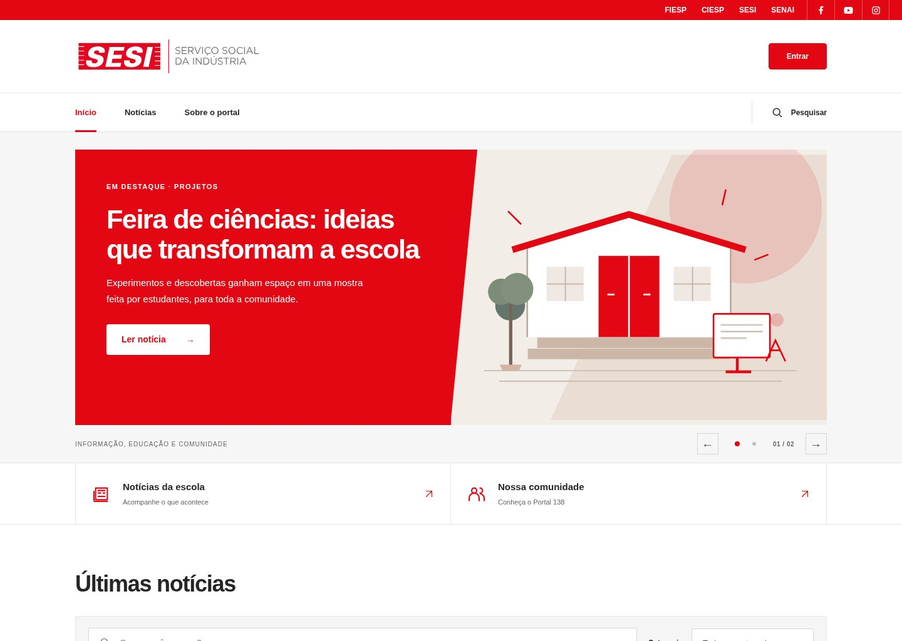
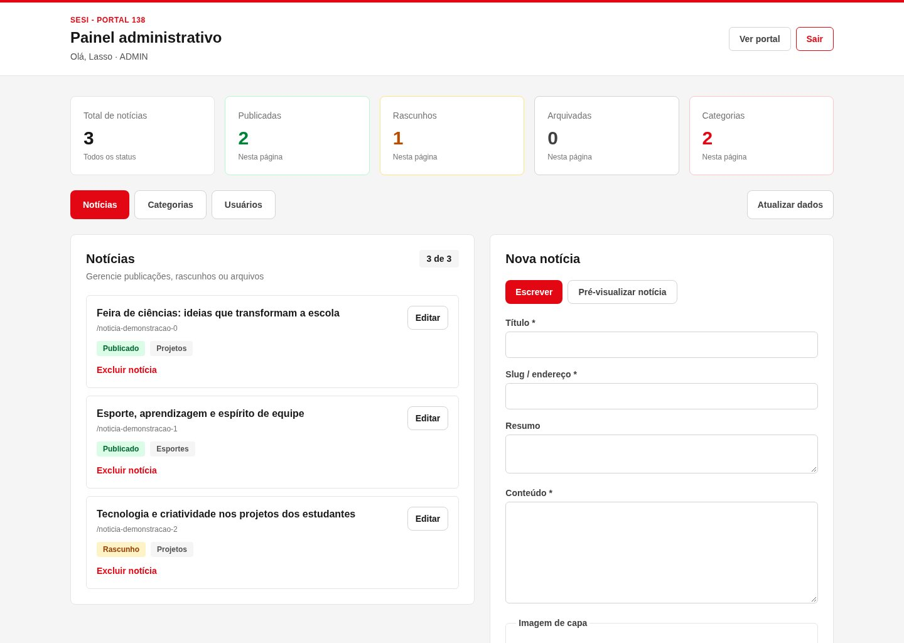
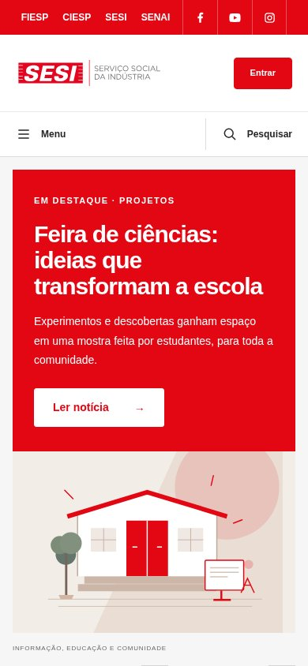

<p align="center">
  
</p>

<p align="center">
  Um portal para acompanhar a vida escolar e dar espaço às histórias da comunidade.
</p>

<p align="center">
  <a href="https://portal-138-0vv9.onrender.com/"><strong>Acessar o site</strong></a>
  &nbsp;·&nbsp;
  <a href="#funcionalidades">Funcionalidades</a>
  &nbsp;·&nbsp;
  <a href="#executar-localmente">Executar localmente</a>
  &nbsp;·&nbsp;
  <a href="#documentação">Documentação</a>
</p>

<p align="center">
  <a href="https://github.com/lassozx/portal-138/actions/workflows/ci.yml"></a>
  
  
  
</p>

## Sobre o projeto

O **Portal 138** é um portal de notícias voltado à comunidade escolar do **SESI 138**,
criado e desenvolvido por **[Lasso](https://github.com/lassozx), estudante do SENAI**.

A aplicação reúne leitura de notícias, participação por comentários e um painel
para organizar o conteúdo e os perfis de acesso. O projeto inclui o cliente web,
a API, o banco de dados, testes automatizados e a configuração de hospedagem.

## Prévia da interface

### Portal de notícias



<details>
<summary><strong>Ver o painel administrativo</strong></summary>

<br>



</details>

<details>
<summary><strong>Ver a versão para celular</strong></summary>

<br>

<p align="center">
  
</p>

</details>

> Capturas da interface do projeto em ambiente local, com notícias e dados fictícios
> para demonstração. O conteúdo do site publicado pode ser diferente.

## Funcionalidades

- **Notícias:** destaques na página inicial, busca, filtros por categoria, paginação
  e página de leitura com autor e data.
- **Publicação de conteúdo:** criação e edição de notícias, prévia antes de salvar
  e organização por status: rascunho, publicado e arquivado.
- **Imagens de capa:** upload de JPG, PNG e WebP de até 5 MB, prévia da imagem e
  opção de usar uma URL externa.
- **Participação da comunidade:** cadastro, login, comentários e exclusão de
  comentários pelo próprio autor ou por um administrador.
- **Contas e permissões:** edição de perfil e senha, criação de contas pelo painel
  e gestão dos perfis de administrador, editor e usuário.
- **Layout responsivo:** navegação, leitura e painel adaptados a telas pequenas.

### Perfis de acesso

| Perfil | O que pode fazer |
| --- | --- |
| **Visitante** | Ler notícias publicadas, pesquisar e consultar comentários. |
| **Usuário** | Comentar, excluir os próprios comentários e atualizar o próprio perfil. |
| **Editor** | Criar e editar notícias e categorias, enviar capas e acessar o painel de conteúdo. |
| **Administrador** | Publicar, arquivar e excluir notícias; gerenciar usuários e perfis; moderar comentários e administrar categorias. |

As permissões são verificadas pela API em cada requisição. O cadastro público
cria contas de usuário; o primeiro administrador é criado por um script interativo.

## Tecnologias

| Camada | Tecnologias |
| --- | --- |
| **Interface** | React 19, JavaScript, Vite e Tailwind CSS |
| **API** | Node.js 24, Express e Zod |
| **Dados** | PostgreSQL, Prisma ORM e migrações versionadas |
| **Autenticação** | JWT e bcrypt |
| **Testes** | Vitest, Testing Library, Jest e Supertest |
| **Entrega** | GitHub Actions, Render e Supabase |

Em desenvolvimento, o PostgreSQL roda via Docker Compose e as capas podem ficar
no disco local. Na hospedagem atual, o **Render** entrega a API e o site compilado,
enquanto o **Supabase** fornece PostgreSQL e armazenamento das imagens.

## Executar localmente

**Pré-requisitos:** Node.js 24 LTS, npm, Git e Docker com Docker Compose.

### 1. Instalar e configurar

```sh
git clone https://github.com/lassozx/portal-138.git
cd portal-138

npm --prefix server ci
npm --prefix client ci
cp server/.env.example server/.env
docker compose up -d postgres
```

Preencha `JWT_SECRET` em `server/.env` com um segredo aleatório de pelo menos
32 caracteres. O [guia de instalação](docs/installation.md) explica como gerar o
segredo e configurar o ambiente. A conexão de exemplo já corresponde ao banco
local do Compose, exposto na porta **5433**.

### 2. Preparar o banco e criar o administrador

```sh
(
  cd server &&
  npx --no-install prisma generate &&
  npx --no-install prisma migrate deploy &&
  node scripts/create-admin.js
)
```

O script solicita nome, e-mail e senha em um terminal interativo. Depois, entre
com essa conta para acessar o painel e publicar notícias.

### 3. Iniciar o portal

Em dois terminais separados, na raiz do projeto:

```sh
# Terminal 1 — API
npm --prefix server run dev
```

```sh
# Terminal 2 — interface
npm --prefix client run dev
```

| Recurso | Endereço local |
| --- | --- |
| Portal | http://localhost:5173 |
| API | http://localhost:3000 |
| Documentação interativa da API | http://localhost:3000/api-docs |

## Testes e qualidade

Após configurar o banco local e aplicar as migrações, execute na raiz:

```sh
npm --prefix server test &&
npm --prefix client test &&
npm --prefix client run build
```

O GitHub Actions executa testes do cliente e da API, aplica as migrações em um
PostgreSQL temporário, gera o build e audita as dependências de produção.
O status da execução mais recente da `main` aparece no badge acima.

O projeto inclui consultas parametrizadas, renderização de conteúdo como texto,
validação dos uploads, limites de tentativas e revogação de sessões anteriores
após troca de senha. Os cenários verificados e as limitações estão no
[relatório de segurança](docs/security.md).

## Estrutura do repositório

```text
portal-138/
├── .github/workflows/       # Testes, auditorias e build no GitHub Actions
├── client/
│   ├── public/             # Favicon e imagens fixas
│   ├── src/
│   │   ├── app/            # Composição do portal e navegação
│   │   ├── components/     # Componentes separados por contexto
│   │   ├── hooks/          # Estado e restauração de sessão
│   │   ├── pages/          # Notícias, login, perfil e painel
│   │   ├── styles/         # Estilos globais
│   │   └── utils/          # Funções auxiliares
│   └── tests/              # Testes da interface
├── server/
│   ├── prisma/             # Schema e migrações
│   ├── scripts/            # Criação inicial de contas e conteúdo
│   ├── src/
│   │   ├── config/         # Banco, ambiente e armazenamento
│   │   ├── middlewares/    # Autenticação, permissões e proteção da API
│   │   ├── routes/         # Endpoints da aplicação
│   │   └── services/       # Armazenamento das imagens
│   └── tests/              # Testes unitários e de integração
├── docs/                   # Guias, imagens e referências do projeto
├── scripts/                # Preparação do build na hospedagem
├── docker-compose.yml      # PostgreSQL local
└── render.yaml             # Configuração do serviço no Render
```

## Documentação

| Guia | Conteúdo |
| --- | --- |
| [Instalação](docs/installation.md) | Ambiente local, variáveis, banco e primeiro administrador |
| [Painel administrativo](docs/administration.md) | Notícias, imagens, usuários e permissões |
| [Desenvolvimento](docs/development.md) | Testes, CI e organização do código |
| [Produção e backups](docs/production.md) | Execução compilada, persistência e cópias de dados |
| [Hospedagem gratuita](docs/hosting-free.md) | Render, Supabase e limites dos planos gratuitos |
| [Segurança](docs/security.md) | Proteções, cenários testados e cuidados na publicação |

## Autoria

Desenvolvido por **[Lasso](https://github.com/lassozx)**, estudante do **SENAI**,
para compartilhar as notícias e histórias da comunidade escolar **SESI 138**.

[Visitar o portal](https://portal-138-0vv9.onrender.com/) ·
[Conhecer o desenvolvedor](https://github.com/lassozx)
